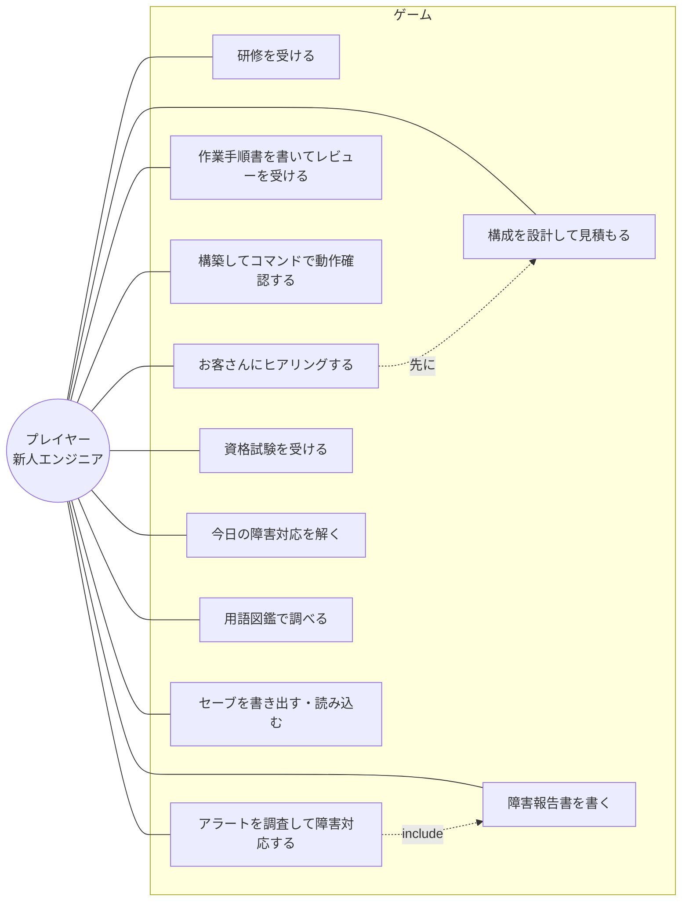
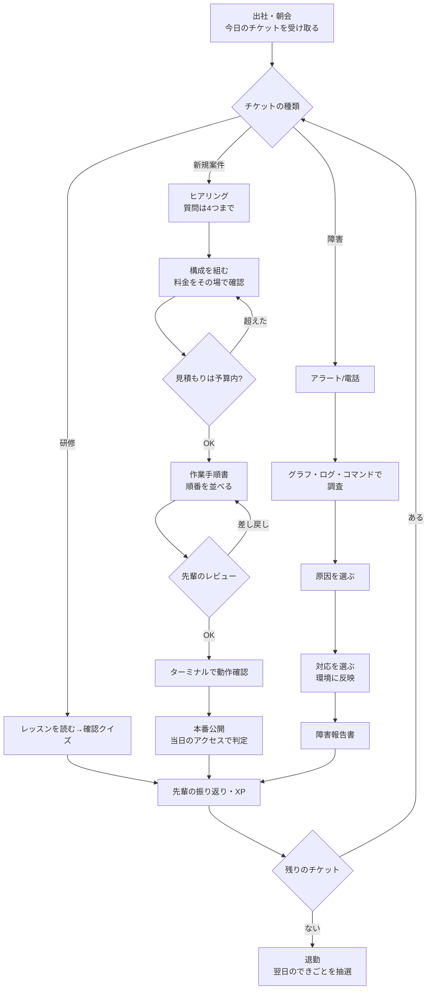
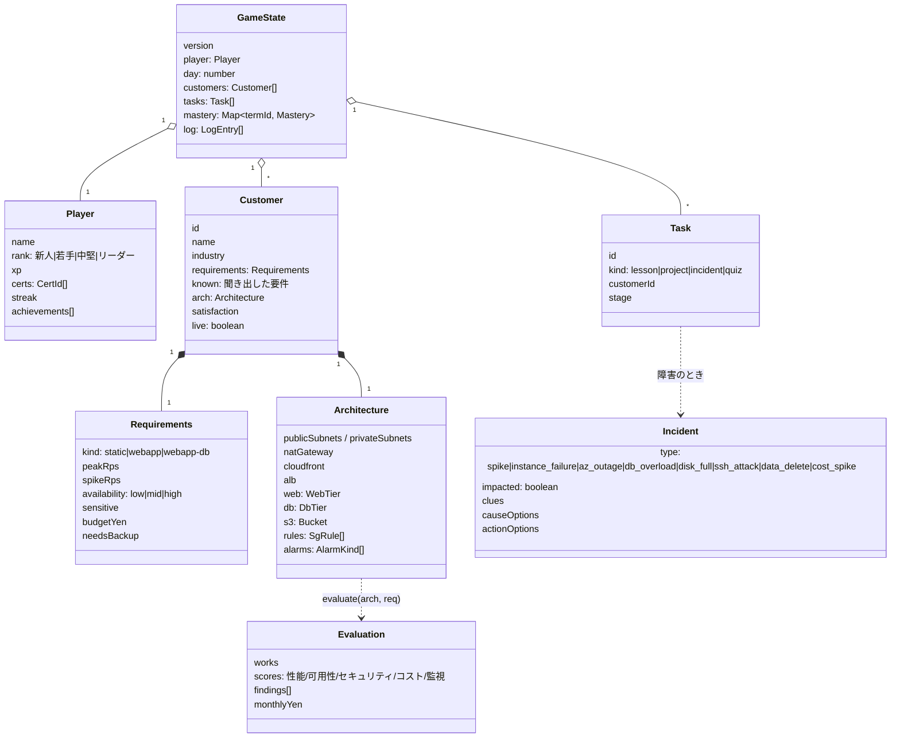
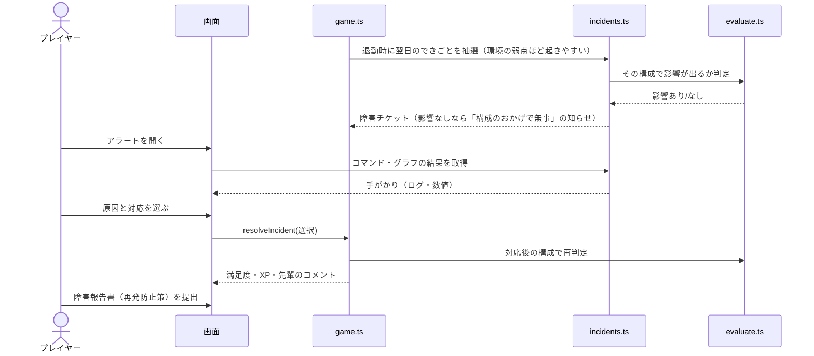
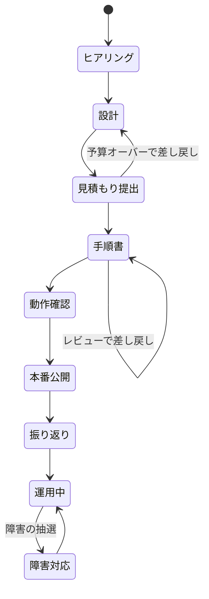
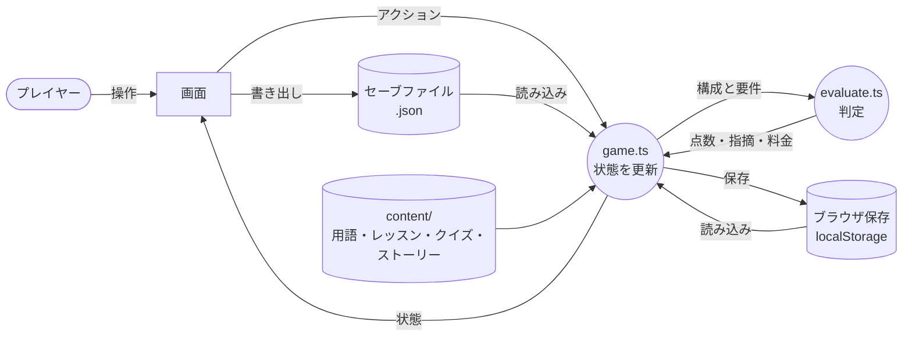

# IT-engineer-sim 設計書

> 最初の職種：クラウドエンジニア（AWSの構築・運用）。
> 今後、SE・SESなどの職種を「職種パック」として追加できる作りにしています。

## 1. ねらい

| ねらい | どう実現するか |
|---|---|
| 現場のエンジニアの仕事をそのまま体験する | 朝会 → チケット → ヒアリング → 設計・見積もり → 作業手順書とレビュー → 構築と動作確認 → 本番 → 監視・障害対応 → 障害報告書、という実際の流れで進む |
| 知識ゼロから遊べて、遊ぶと知識がつく | 1週目は研修。用語はタップで解説、ヒントは3段階、失敗すると先輩が理由を説明する |
| 飽きずに続けられる | 作った環境があとで返ってくる（アクセス集中・障害・コスト相談）。案件は毎回ランダム。出世と資格、日替わりの障害対応、図鑑と称号、苦手の復習 |
| スマホ（iPhone）で遊ぶ | 縦画面・片手操作、タップだけで構成を組む、コマンドは候補をタップして組み立てる。ホーム画面に追加して使う（PWA） |

## 2. ユースケース図

## 3. 1日の流れ（フローチャート）

## 4. クラス図（ゲームの中身）

計算部分（`src/engine`）は画面（`src/ui`）から切り離してあり、テスト（Vitest）で中身だけを確かめられます。

## 5. シーケンス図：障害対応

## 6. 状態遷移図：案件チケット

## 7. データの流れ（DFD）

## 8. 判定のルール（ゲーム用の簡略化）

### 8.1 処理能力
- EC2 1台がさばけるリクエスト/秒：t3.micro 40、t3.small 80、t3.medium 160、t3.large 320
- ロードバランサー（ALB）がないと、トラフィックを受けるのは1台だけ
- Auto Scaling（ALBが必要）は、アクセス集中のとき最大台数まで増える
- CloudFront を前に置くと、Webサーバーへのリクエストが減る（動的サイトで−50%）
- RDS の処理能力：db.t3.micro 100、small 200、medium 400、large 800

### 8.2 可用性
- `high`（24時間止められない）：Webが2つのAZに2台以上＋ALB、DBはMulti-AZ
- `mid`（営業時間は止めたくない）：1台が壊れても復旧できる（2台以上またはAuto Scaling）、DBのバックアップあり
- `low`：止まってもすぐ困らない

### 8.3 セキュリティの指摘
- SSH（22番）が全世界に開いている
- DB（3306番）が全世界に開いている・DBがパブリックサブネットにある
- 個人情報を扱うのにHTTPS（443番）を使っていない
- S3のパブリックアクセスブロックがオフ
- 請求アラームがない（軽い指摘）

### 8.4 料金
東京リージョンのおおよその価格（1ドル150円、1か月730時間）をもとにしたゲーム用の目安です。実際の料金は AWS の料金ページで確認してください。

## 9. 飽きない仕組み

1. **環境が返ってくる**：作った環境はお客さんごとに残る。退勤時の抽選で、弱点のある環境ほど障害が起きやすい。強い構成なら「構成のおかげで無事」と知らせが来る
2. **ランダム案件**：業種・規模・予算・要件の組み合わせで毎回ちがう
3. **出世と資格**：新人→若手→中堅→リーダー。ゲーム内資格（AWS認定の範囲に合わせたクイズ）で昇格条件を満たす。ランクが上がると大きい案件が来る
4. **今日の障害対応**：日付で決まる短い問題を1日1問、連続日数を記録
5. **図鑑と称号**
6. **苦手の復習**：間違えた用語は数日後の確認クイズにもう一度出る

## 10. 職種を増やすときの拡張点

- `src/content/jobs/` に職種ごとのストーリー・レッスン・案件の型を置く
- 判定（`evaluate`）は職種ごとに差し替える（SE：要件定義書・テスト仕様、SES：常駐先の案件と単価…）
- 共通部分：1日の流れ、チケット、先輩の振り返り、XPと出世、用語図鑑、セーブ

## 11. セーブ

- ブラウザの localStorage に自動保存。セーブには `version` を入れ、読み込みで古い形を新しい形に変換する
- 読めないセーブは消さずに別の場所へ退避する（以前、別のゲームで読み込み失敗時に上書きしてセーブを失ったため）
- 「書き出す」でJSONファイルを保存、「読み込む」で戻す。iPhoneは「ファイル」アプリやOneDriveに保存できる
- iPhoneのSafariは、しばらく開かないサイトの保存データを消すことがあるので、ホーム画面に追加して使うのがおすすめ
